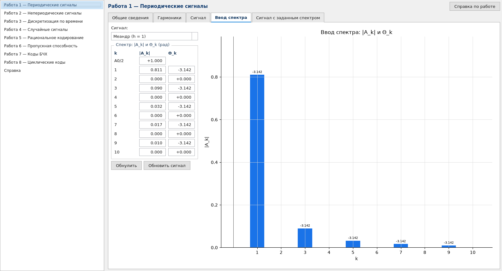

# КУ ОТИК для macOS

[](https://github.com/wlix13/kuotik-mac/actions/workflows/ci-tests.yaml)
[](https://github.com/wlix13/kuotik-mac/actions/workflows/build.yaml)
[](https://www.python.org)
[](https://doc.qt.io/qtforpython/)
[](https://www.apple.com/macos/)
[](LICENSE)

«КУ ОТИК» — компьютерный учебник по теории информации и кодирования кафедры №12 НИЯУ МИФИ: восемь
лабораторных с расчётами и графиками. Написан на Delphi 7 и работал только под Windows. Это его перенос
на macOS: те же работы, те же поля, справка внутри приложения.



## Что умеет

- Восемь работ: периодические и непериодические сигналы, дискретизация, случайные сигналы и оптимальный
  приём, рациональное кодирование, пропускная способность канала, коды БЧХ, циклический код Хэмминга.
- Считает те же величины, что оригинал, и строит графики на месте. Wine, CrossOver и RDP не нужны.
- Справка внутри: те же страницы, что в `.chm`, вместе с формулами.
- Проверки сверяют числа с оригиналом и с аналитикой: `scripts/check_all.py` прогоняет их одной командой.

## Чего нет

- Windows-сборка есть, но живёт в CI: руками её никто не запускал.
- Растровых картинок на вкладках теории: там текст справки, а не сканы из программы.
- Сетевых затей оригинала: ввода пароля и отдельного окна «Сборник задач».

## Скачать

Готовые архивы лежат в [релизах](https://github.com/wlix13/kuotik-mac/releases): `kuotik-macos.zip`,
`kuotik-windows.zip`, `kuotik-linux.tar.gz`. Сборки не подписаны.

Linux-архиву нужны системные `libgl1` и `libegl1` — без них Qt не стартует.

## Быстрый старт

```bash
git clone https://github.com/wlix13/kuotik-mac.git
cd kuotik-mac
uv run kuotik
```

Нужны macOS 12+ (Apple Silicon или Intel), Python 3.12+ и [uv](https://docs.astral.sh/uv/). Без `uv`:

```bash
python3 -m venv .venv && .venv/bin/pip install -e . && .venv/bin/kuotik
```

Первый запуск скачивает PySide6, это около 250 МБ.

## Работы

| № | Что считается |
|---|---|
| 1 | Ряд Фурье периодического сигнала: гармоники, спектр, синтез по заданному спектру |
| 2 | Спектральная плотность, фаза, энергия в полосе, ряд Котельникова |
| 3 | Дискретизация: спектр отсчётов, наложение частот, АКФ, СПМ, восстановление ФНЧ |
| 4 | Случайные сигналы и приём: критерии, вероятность ошибки, согласованный фильтр |
| 5 | Сжатие n-блоков: КДС, АПК, ИПП, УК |
| 6 | Пропускная способность двоичного канала: ДК, ДСКС, поверхности C = F(p, q) |
| 7 | Коды БЧХ: GF(2^m), порождающий полином, декодирование PGZ и CS |
| 8 | Циклический код Хэмминга: кодер и декодер на регистре сдвига, синдромы |

## Проверки

```bash
uv run python scripts/check_all.py
```

Те же проверки идут в CI на Ubuntu, Windows и macOS: `ci-tests.yaml` гоняет их на каждом пуше.

Скрипт гоняет проверки всех работ и печатает итог. Отдельная работа запускается так же:
`uv run python scripts/check_lab7.py`. Все проверки headless и кладут снимки в `/tmp/shots*`.

## Сборка .app

Workflow `build` собирает архивы под три системы на каждый пуш в `main` и прикладывает их к релизу
на теге `v*`. Локально на маке:

```bash
uv sync && uv run pyinstaller packaging/macos.spec --noconfirm
open "dist/КУ ОТИК.app"
```

Бандл не подписан. Первый запуск — правый клик → «Открыть», либо
`xattr -dr com.apple.quarantine "dist/КУ ОТИК.app"`.

## Устройство

```
kuotik_port/
  app.py          окно, список работ, справка
  labs/labN.py    страница работы: вкладки, поля, расчёты
  mathlib/        spectra.py и pulses.py — математика работ 1 и 2
  theory.py       вкладка «Общие сведения» из страниц справки
  helpview.py     просмотр справки, распаковка help.zip
  theme.py        шрифты и оформление
```

Поля и подписи повторяют формы оригинала: их дерево восстановлено из ресурсов DFM в `Project1.exe`.
Формулы берутся из справки, где они лежали в WMF; в репозитории они уже переведены в SVG.

## Лицензия

Код — MIT, см. [LICENSE](LICENSE). Справка и материалы оригинала принадлежат их авторам, подробности в
[NOTICE](NOTICE.md).
